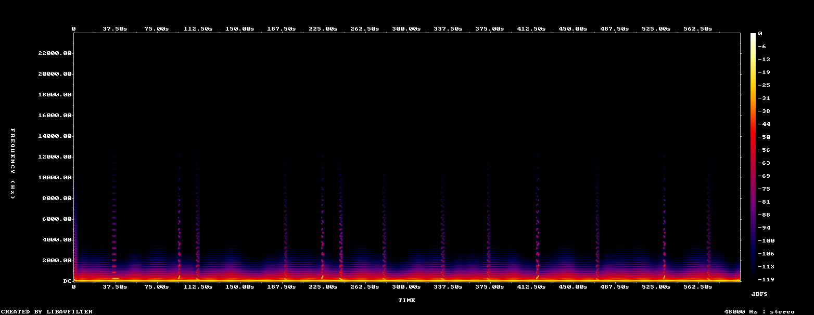

# Lab report — 2026-10-14-aircraft-with-reverb-ground-forward

Rendered from `lab/renders/2026-10-14-aircraft-with-reverb-ground-forward.wav` · 600.0 s · 48000 Hz

> Claude cannot hear (SPEC §7.2). Everything below is a number or an image.
> **No musical change may be adopted on these numbers alone** — §7.3 step 5
> requires a human A/B win, logged in `docs/music/listening-log.md`.

## Mix safety (SPEC §6.8)

| Measure | Value | Target |
|---|---|---|
| Integrated loudness | -20.0 LUFS | ≈ −20 LUFS |
| Loudness range | 5.4 LU | — |
| True peak | -1.9 dBTP | ≤ −1 dBTP |

Loudness verdict: -20.0 LUFS — within target -22…-18 LUFS

## Density (SPEC §6.5)

- Onsets heard: **5** → **0.5 per minute**
- Target band: night 2–6, day 6–14 per minute
- Per-minute series: [0.0, 1.0, 0.0, 2.0, 1.0, 1.0, 0.0, 0.0, 0.0, 0.0]

## Harmony and monotony (SPEC §6.2, §6.7)

- Dominant pitch class: **A**
- Pitch-class entropy: **1.466** of 3.585 bits
  (low means the piece is stuck on a few notes)
- Histogram: {'C': 0.001, 'C#': 0.001, 'D': 0.456, 'D#': 0.0035, 'E': 0.0105, 'F': 0.0095, 'F#': 0.0031, 'G': 0.0004, 'G#': 0.0195, 'A': 0.4774, 'A#': 0.0144, 'B': 0.0037}
- Repetition score: **0.9911** (1.0 = repeating itself, 0 = always moving)

## Spectrogram

Look for: sustained energy above ~6 kHz (§6.8 forbids it), a static band pattern repeating at a fixed period (loop fatigue), and dead silence.

## What a human still has to decide

These numbers cannot tell you whether it is *pleasant*. Render an A and a B from the same recording and the same seed, play both to the panel, and log the result (§7.3 step 5).
