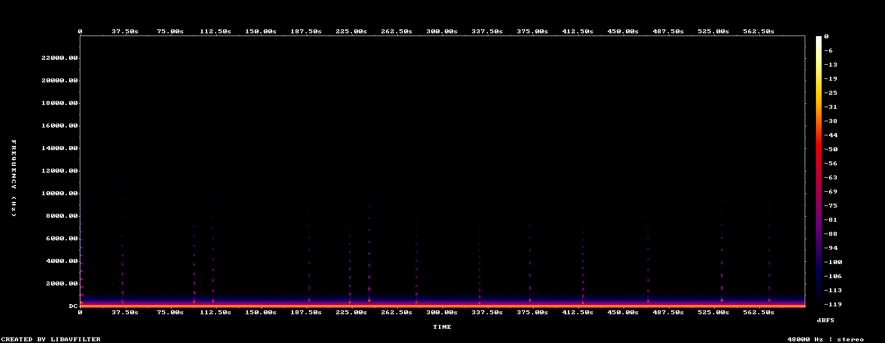

# Lab report — 2026-10-14-phase0-probe

> ## ⚠ THIS IS A MEASUREMENT FIXTURE, NOT MUSIC
>
> Rendered with `lab/fixtures/probe-voice.ts` — one bell per event and a
> single drone — which exists only to prove the render → measure → report
> chain works, and afterwards to tell a renderer change from a music change.
>
> **It is supposed to sound bad.** The loudness, repetition and pitch-entropy
> figures below are correct readings of a deliberately crude fixture. Do not
> read them as musical problems, do not tune anything to improve them, and do
> not cite this report in an A/B comparison. See `docs/music/decisions.md`.

Rendered from `lab/renders/2026-10-14-deterministic-phase0.wav` · 600.0 s · 48000 Hz

> Claude cannot hear (SPEC §7.2). Everything below is a number or an image.
> **No musical change may be adopted on these numbers alone** — §7.3 step 5
> requires a human A/B win, logged in `docs/music/listening-log.md`.

## Mix safety (SPEC §6.8)

| Measure             | Value      | Target     |
| ------------------- | ---------- | ---------- |
| Integrated loudness | -28.6 LUFS | ≈ −20 LUFS |
| Loudness range      | 1.5 LU     | —          |
| True peak           | -7.0 dBTP  | ≤ −1 dBTP  |

Loudness verdict: -28.6 LUFS — OUTSIDE target -22…-18 LUFS

## Density (SPEC §6.5)

- Onsets heard: **13** → **1.3 per minute**
- Target band: night 2–6, day 6–14 per minute
- Per-minute series: [2.0, 1.0, 0.0, 3.0, 1.0, 1.0, 2.0, 1.0, 1.0, 1.0]

### Engine-side counts (authoritative)

- events replayed: 15
- events dropped by the voice budget: 0
- voices stolen: 0
- reproducible render: True
- sha256: `20ccdbfec697e517266cd73ff11d83a308378b119638bc2c4ee25f34b937c5b2`

## Harmony and monotony (SPEC §6.2, §6.7)

- Dominant pitch class: **D**
- Pitch-class entropy: **0.386** of 3.585 bits
  (low means the piece is stuck on a few notes)
- Histogram: {'C': 0.0006, 'C#': 0.0011, 'D': 0.9516, 'D#': 0.0068, 'E': 0.0096, 'F': 0.0245, 'F#': 0.002, 'G': 0.0006, 'G#': 0.0016, 'A': 0.0003, 'A#': 0.0004, 'B': 0.0007}
- Repetition score: **0.9934** (1.0 = repeating itself, 0 = always moving)

## Spectrogram

Look for: sustained energy above ~6 kHz (§6.8 forbids it), a static band pattern repeating at a fixed period (loop fatigue), and dead silence.

## What a human still has to decide

These numbers cannot tell you whether it is _pleasant_. Render an A and a B from the same recording and the same seed, play both to the panel, and log the result (§7.3 step 5).
